 

---

## 👨‍💻 About Me

I'm Kevon, a Computer Science graduate from Queens College, CUNY, with a background in Electromechanical Engineering Technology.

My interests span software development, IT infrastructure, computer networking, cybersecurity, and hardware engineering. I enjoy working on projects that challenge me to understand how technology works, troubleshoot problems, and build practical solutions.

- 🎓 **Education:** B.S. Computer Science — Queens College, CUNY
- 💼 **Experience:** Digital Intern — Vanguard Digital
- 🖥️ **Career Interests:** IT Support, Systems Administration, Networking, and Software Development
- 🔧 **Hands-on Interests:** Computer Hardware, Electronics, Arduino, and Embedded Systems
- 📚 **Currently Learning:** Advanced Web Development, Networking, and IT Infrastructure
- 🤝 **Open To:** Technical Opportunities and Project Collaborations

---

## 🛠️ Technical Skills

### 💻 Programming Languages

### 🌐 Frameworks & Libraries

### 🗄️ Databases & Deployment

### ⚙️ Tools, Operating Systems & Hardware

---

## 🚀 Featured Projects

### 🏙️ CityPulse Queens

A full-stack community events platform that allows users to explore upcoming events across different Queens neighborhoods.

**Technologies:** React, Express, PostgreSQL

- Location-based event browsing
- Database-backed event listings
- Dynamic event pages and filtering

[View Repository](https://github.com/KDawTech/web103_unit3_project)

### 🛠️ HobbyHub

A community-driven platform for sharing projects, interests, and discussions.

**Features:**
- Create, edit, and delete posts
- Comment and interact with other users
- Upvote content
- Search and sort posts

[View Repository](https://github.com/KDawTech/final-project-web-102)

### 🏎️ F1 Pulse

A Formula 1 race prediction platform with an interactive interface and frontend-to-backend communication.

**Technologies:** Next.js, TypeScript, FastAPI, Python

[View Repository](https://github.com/KDawTech/F1-Pulse)

### 📚 Flashcards Study Application

An interactive web application designed to make studying more engaging.

**Features:**
- Question and answer validation
- Flashcard navigation
- Randomized questions
- Responsive interface

[View Repository](https://github.com/KDawTech/flashcards-app2)

### 🌐 Personal Portfolio

My personal website highlighting my technical skills, experience, and projects.

[Visit Portfolio](https://kdawtech.netlify.app/)

---

## 📊 GitHub Statistics

---

## 📈 Contribution Activity

---

## 🎯 Professional Interests

| Area | Focus |
|------|-------|
| 🖥️ IT Infrastructure | Technical Support, Troubleshooting, Systems |
| 🌐 Networking | Network Configuration, Connectivity, Infrastructure |
| 🔐 Cybersecurity | System Security, Network Security, Security Fundamentals |
| 💻 Development | Web Applications, APIs, Databases |
| 🔧 Hardware | Computer Systems, Electronics, Arduino |
| ☁️ Cloud | Cloud Services, Deployment, Infrastructure |

---

## 📬 Let's Connect

I'm interested in connecting with technology professionals, exploring technical opportunities, and collaborating on meaningful projects.

**Email:** kevon.dawkins@outlook.com

---

